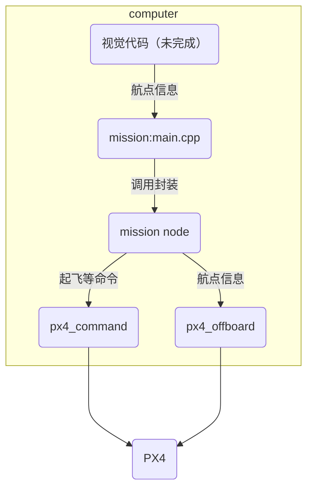

这是一个控制四旋翼无人机航点飞行的代码
# 使用的技术栈

# node: mission

> 状态机
>
> 1. arm
> 2. 进入offborad mode
> 3. 起飞（可选）
> 4. 航点控制，可以由其他模块控制
> 5. 降落（可选）

### action_client:

/mission/arm (mission_msgs/action/Arm.action)

/mission/offboard (mission_msgs/action/Offboard.action)

/mission/setpoint (mission_msgs/action/Setpoint.action)

/mission/takeoff (mission_msgs/action/Takeoff.action)

/mission/landing (mission_msgs/action/Landing.action)

# Node: px4_command

> publisher与subscriber是action的执行内容，goal为参数，result为Ack中是否成功
>
> arm中至少发送5次，确保已经建立通讯
>
> takeoff与landing中的feedback为实时高度

### action_server

除了setpoint以外的/mission/...

### publisher:

/fmu/in/vehicle_commmand (px4_msgs/msg/VehicleCommand.msg)

### subscriber

/fmu/out/vehicle_command_ack (px4_msgs/msg/VehicleCommandAck.msg)

其他需要监视的信息

# Node: px4_offboard

> 注意心跳信息>=2Hz

### action_server

/mission/setpoint

### publisher:

/fmu/in/offboard_control_mode (px4_msgs/msg/OffboardControlMode.msg)  --- >=2Hz

/fmu/in/trajectory_setpoint (px4_msgs/msg/TrajectorySetPoint.msg)

# subscriber

>大体是这样，实际写的时候会有细微调整，比如offboard节点好像是加上了检测信息