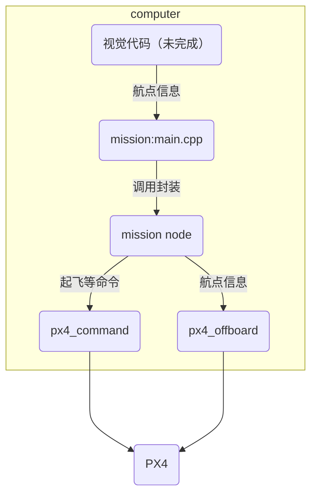

这是一个控制四旋翼无人机航点飞行的代码
# 使用的技术栈


# 仿真

|操作系统|Ubuntu 24\.04\.4 LTS x86\_64 |
|---|---|
|ROS版本|Jazzy Jalisco LTS|
|上位机中间件|Micro XRCE\-DDS Agent v2\.4\.3 |
|飞控版本|PX4\-Autopilot v1\.17|
|仿真环境|Gazebo sim 8 harmonic|

## 环境准备

### ros2安装

ros2的安装可以在官网找到：https://docs\.ros\.org/en/rolling/Installation/Ubuntu\-Install\-Debs\.html 需要注意的是，ros2的版本要根据你所选系统相匹配。

```Bash
sudo apt install software-properties-common
sudo add-apt-repository universe
sudo apt update && sudo apt install curl -y
export ROS_APT_SOURCE_VERSION=$(curl -s https://api.github.com/repos/ros-infrastructure/ros-apt-source/releases/latest | grep -F "tag_name" | awk -F'"' '{print $4}')
curl -L -o /tmp/ros2-apt-source.deb "https://github.com/ros-infrastructure/ros-apt-source/releases/download/${ROS_APT_SOURCE_VERSION}/ros2-apt-source_${ROS_APT_SOURCE_VERSION}.$(. /etc/os-release && echo ${UBUNTU_CODENAME:-${VERSION_CODENAME}})_all.deb"
sudo dpkg -i /tmp/ros2-apt-source.deb
sudo apt update
sudo apt upgrade
sudo apt install ros-jazzy-desktop
```

### 中间件安装

uXRCE\-DDS Agent的安装可以参考px4的官网：https://docs\.px4\.io/main/en/middleware/uxrce\_dds

需要注意是，同样的，中间件的版本需要跟ros2版本相匹配

```Bash
git clone -b v2.4.3 https://github.com/eProsima/Micro-XRCE-DDS-Agent.git
cd Micro-XRCE-DDS-Agent
mkdir build
cd build
cmake ..
make
sudo make install
sudo ldconfig /usr/local/lib/
```

### Gazebo sim 安装

参考官网：https://gazebosim\.org/docs/latest/ros\_installation/

需要注意的是，以下命令需要在安装ros2完毕后进行

```Bash
sudo apt-get install ros-${ROS_DISTRO}-ros-gz
```

### px4 sitl 编译

参考官网：https://docs\.px4\.io/main/en/sim\_gazebo\_gz/

这里为了方便，在命令中多加了一步获取px4源码的命令

```Bash
git clone https://github.com/PX4/PX4-Autopilot.git
cd PX4-Autopilot
make px4_sitl gz_x500
```


## 仿真过程

### 启动仿真命令

需要打开五个终端，同时，打开QGC，否则px4禁止解锁。

```Bash
MicroXRCEAgent udp4 -p 8888
```

```Bash
cd path/to/PX4-Autopilot
make px4_sitl gz_x500
```

```Bash
cd path/to/fly_frame # 根据实际情况更改代码
source install/setup.bash
ros2 run px4_offboard px4_offboard
```

```Bash
cd path/to/fly_frame # 根据实际情况更改代码
source install/setup.bash
ros2 run px4_command px4_command
```

```Bash
cd path/to/fly_frame # 根据实际情况更改代码
source install/setup.bash
ros2 run mission mission
```

# 修改代码的方法
对于简单航点飞行来说，直接修改`mission/src/main.cpp`中`std::vector<MissionPoint> mission_points`即可。

对于进阶飞行，可以根据现有示例文件重写`mission/src/main.cpp`，通过其他方式与本框架相连

其中函数`void set_point(double x, double y, double z, uint8_t control_type = 0);`即为航点控制函数，可以修改控制模式为位置、速度、加速度控制

# 实物硬件

## 硬件准备

### 四旋翼飞机准备

首先需要准备好一架四旋翼飞机和遥控器，能够在position模式下稳定、安全飞行。也就是说，这架飞机能够达到以下指标：

1. 推力与载重匹配，能够正常起飞

2. 具有保护措施，场地安全可控，飞机可以紧急锁桨

3. 传感器校准完毕

4. pid调整准确

### 通讯准备

为了与上位机通讯需要将px4飞控与电脑相连。常见的连接方式大体可以分为两种：串口和网络。这里选择的是有线串口通讯方法，因此需要准备通讯线

这里以pixhawk 6c飞控，telem2端口与电脑USB连接为例。

工具准备：telem2信号线一根，TTL转USB模块一个，这里以ch340为例。

接线时将telem2信号线中pin2与ch340模块中pin5相连，telem2信号线中pin3与ch340模块中pin4相连，telem2信号线中pin6与ch340模块中pin6相连，共计3根线

telem2端口6根信号线：

|Pins|Signal|
|---|---|
|1\(Red\)|VCC|
|2\(Black\)|UART\_TX|
|3\(Black\)|UART\_RX|
|4\(Black\)|UART\_CTS|
|5\(Black\)|UART\_RTS|
|6\(Black\)|GND|

ch340模块接头

|Pins|Signals|
|---|---|
|1（与2以跳线帽相连）|5V|
|2（与1以跳线帽相连）|VCC|
|3|3V3|
|4|TXD|
|5|RXD|
|6|GND|

图示如下

在此之后，需要在上位机中查看这条线被分配的串口，

然后在QGC里面调整参数如下：

```Plain Text
UXRCE_DDS_CFG : TELEM2
SER_TEL2_BAUD : 115200
```

### 启动命令

使用ssh在监控机启动4个命令行

通讯连接命令

```Bash
MicroXRCEAgent serial -D /dev/ttyUSB0 -b 115200 # 根据实际情况更改代码
```

飞行启动命令

```Bash
cd path/to/fly_frame # 根据实际情况更改代码
source install/setup.bash
ros2 run px4_offboard px4_offboard
```

```Bash
cd path/to/fly_frame # 根据实际情况更改代码
source install/setup.bash
ros2 run px4_command px4_command
```

```Bash
cd path/to/fly_frame # 根据实际情况更改代码
source install/setup.bash
ros2 run mission mission
```

